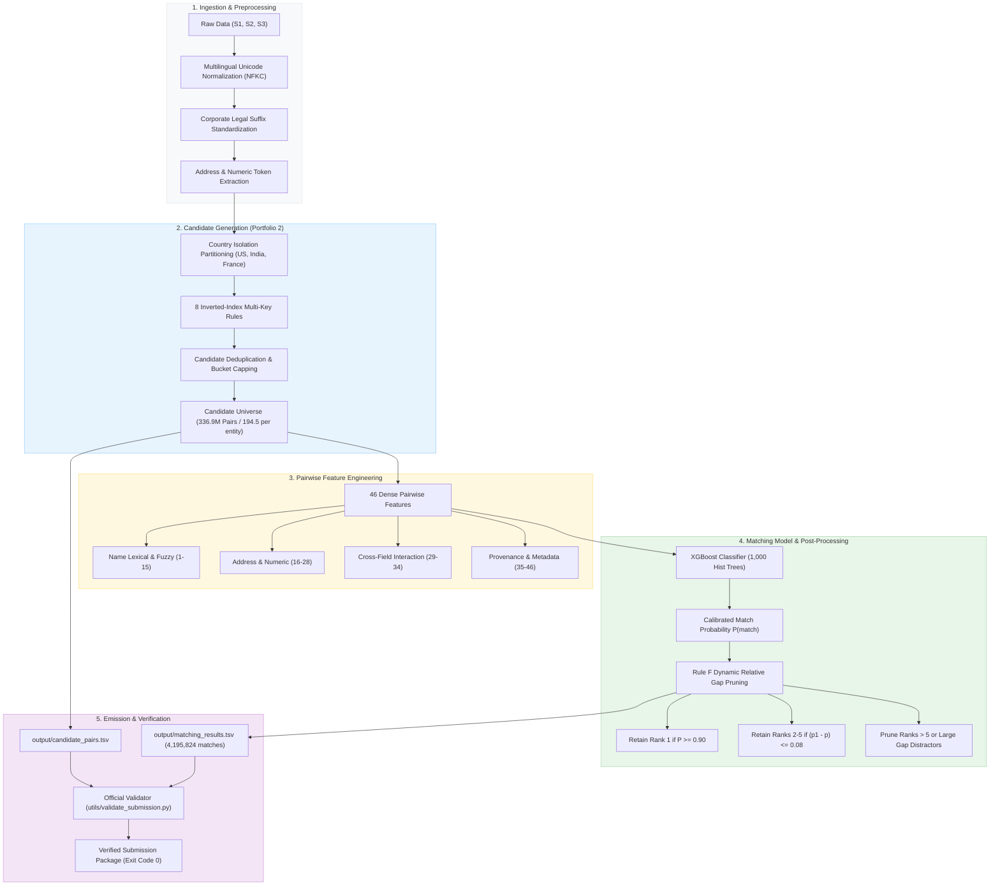

<div align="center">

# 🐉 Wyvern
### Large-Scale Multilingual Business Entity Resolution at Scale
**Amazon ML Challenge 2026**

[](https://www.python.org/)
[](#benchmark-results)
[](#benchmark-results)
[](LICENSE)
[](.github/workflows/ci.yml)
[](https://xgboost.readthedocs.io/)

*An end-to-end, high-recall, precision-optimized entity resolution pipeline designed to resolve noisy commercial business records across multiple heterogeneous data sources into unified real-world entities.*

---

**Team Name:** Wyvern  
**Team Members:** Anish Karak, Soumya Gupta, Souvik Ghosh  

</div>

---

## 📌 Table of Contents

- [1. Executive Summary](#1-executive-summary)
- [2. Problem Formulation & Metric](#2-problem-formulation--metric)
- [3. System Architecture](#3-system-architecture)
- [4. Methodology Deep-Dive](#4-methodology-deep-dive)
  - [4.1 Deterministic Multilingual Normalization](#41-deterministic-multilingual-normalization)
  - [4.2 Portfolio 2 (P2) Blocking Engine](#42-portfolio-2-p2-blocking-engine)
  - [4.3 Pairwise Feature Engineering (46 Features)](#43-pairwise-feature-engineering-46-features)
  - [4.4 XGBoost Ranking Model](#44-xgboost-ranking-model)
  - [4.5 Rule F Dynamic Relative Gap Pruning](#45-rule-f-dynamic-relative-gap-pruning)
- [5. Benchmark Results & Ablation Studies](#5-benchmark-results--ablation-studies)
- [6. Repository Structure](#6-repository-structure)
- [7. Getting Started](#7-getting-started)
  - [Installation](#prerequisites--installation)
  - [Running Unit Tests](#running-unit-tests)
  - [Quickstart with Sample Data](#quickstart-with-sample-data)
- [8. Pipeline Execution & Reproduction](#8-pipeline-execution--reproduction)
- [9. Compliance & Fair Play](#9-compliance--fair-play)
- [10. Team & License](#10-team--license)

---

## 1. Executive Summary

In commercial data ecosystems, records describing real-world business entities arrive from heterogeneous sources without shared primary keys. Records contain noisy names, local language transliterations, landmark-oriented addresses, missing postal codes, and branch variations.

**Wyvern** delivers a production-grade, modular entity resolution framework that scales to billions of candidate comparisons while optimizing for precision-weighted evaluation:
- **Massive Scale:** Resolved **1,732,544** test entities against secondary sources across **336,928,889** candidate pairs ($>99.994\%$ space reduction ratio).
- **Public Leaderboard Score:** **`0.780`** Macro $F_{0.5}$.
- **Held-Out Validation:** **`0.80526`** Macro $F_{0.5}$ (88.3% precision, 67.6% recall).
- **Zero External Lookups:** Strict adherence to closed-set constraints with no external APIs, search engines, or pre-trained proprietary LLMs.
- **Universal Compliance:** 100% S1 row coverage, 0 subset violations, 0 invalid IDs, fully verified with the official submission validator.

---

## 2. Problem Formulation & Metric

Given three tabular data sources:
- **Source 1 ($S_1$):** Reference deduplicated business entities ($1,732,544$ records in test).
- **Source 2 ($S_2$) & Source 3 ($S_3$):** Target candidate entities containing zero, one, or multiple matches for each $S_1$ record.

The goal is to predict the set of target IDs $\mathcal{M}(e_1) \subseteq S_2 \cup S_3$ corresponding to each reference entity $e_1 \in S_1$.

### Evaluation Metric: Entity-Level Macro $F_{0.5}$

$$\text{Precision}(e_1) = \frac{|\mathcal{M}(e_1) \cap \mathcal{G}(e_1)|}{|\mathcal{M}(e_1)|}, \quad \text{Recall}(e_1) = \frac{|\mathcal{M}(e_1) \cap \mathcal{G}(e_1)|}{|\mathcal{G}(e_1)|}$$

$$F_{0.5}(e_1) = \frac{(1 + 0.5^2) \cdot \text{Precision} \cdot \text{Recall}}{0.5^2 \cdot \text{Precision} + \text{Recall}} = \frac{1.25 \cdot \text{Precision} \cdot \text{Recall}}{0.25 \cdot \text{Precision} + \text{Recall}}$$

$$\text{Macro } F_{0.5} = \frac{1}{|S_1|} \sum_{e_1 \in S_1} F_{0.5}(e_1)$$

**Key Metric Characteristics:**
1. **Precision Emphasis:** False positive merges are penalized **twice as heavily** as missed matches ($2\times$ weight on precision).
2. **Singletons ($\mathcal{G}(e_1) = \emptyset$):** Correctly predicting an empty set yields $F_{0.5} = 1.0$; a single false match drops the score immediately to $0.0$.
3. **Branch Distractor Penalty:** Large corporate chains (banks, retail chains) trigger runaway false merges unless strictly controlled.

---

## 3. System Architecture



---

## 4. Methodology Deep-Dive

### 4.1 Deterministic Multilingual Normalization
Implemented in `src/preprocessing/normalization.py`:
- **Unicode NFKC Preservation:** Resolves full-width/half-width ambiguities and composite character representations while strictly **preserving multilingual accents and diacritics** (e.g. French accents and Hindi transliterations) to prevent destructive collisions.
- **Legal Entity Standardization:** Strips jurisdictional corporate suffixes (e.g., `pvt ltd`, `inc`, `corp`, `llc`, `gmbh`, `sarl`, `societe par actions simplifiee`) without erasing entities whose entire name consists of legal terms.
- **Address & Numeric Parsing:** Standardizes common road abbreviations (`rd` $\to$ `road`, `st` $\to$ `street`) and extracts numeric strings $\ge 3$ digits (house numbers, postal codes, suite numbers) for high-precision inverted indexing.

### 4.2 Portfolio 2 (P2) Blocking Engine
Comparing $1.73\text{M} \times 3.5\text{M}$ pairs requires $\sim 6.06 \times 10^{12}$ comparisons. **Portfolio 2** utilizes 8 deterministic indexing rules executed per isolated country:

| # | Rule Name | Keys | Bucket Cap | Targeted Match Pattern |
|:---:|:---|:---|:---:|:---|
| 1 | `rule_stripped_name` | `(country, stripped_name)` | Uncapped | Exact match on alphanumeric business name |
| 2 | `rule_first_2_tokens` | `(country, first_2_tokens)` | 200 | Multi-word names sharing primary brand prefix |
| 3 | `rule_name_pfx8` | `(country, name_pfx8)` | 200 | Trailing typos, legal variants, branch suffixes |
| 4 | `rule_addr_num_initial` | `(country, addr_num_ge_3, name_initial)` | 100 | Street building number + first letter of name |
| 5 | `rule_fw_addr_num` | `(country, first_word_ge_3, addr_num_ge_3)` | 100 | Primary brand word + street building number |
| 6 | `rule_sorted_tok2` | `(country, sorted_first_2_tokens)` | 200 | Inverted word order (e.g. *McDonald's Restaurant* vs *Restaurant McDonald's*) |
| 7 | `rule_fw4` | `(country, first_word_ge_4)` | 50 | Unique corporate names where address is missing/noisy |
| 8 | `rule_rare_tok_addr_num` | `(country, rare_tok_df_le_100, addr_num_ge_3)` | 100 | Rare catalog token ($DF \le 100$) + street number |

- **Recall Achievement:** Recovers **$75.09\%$** of all ground-truth matches on 10,002 held-out entities ($+1,182$ matches over baseline 4-rule blocking).

### 4.3 Pairwise Feature Engineering (46 Features)
Extracted via `src/features/pair_features.py`:
1. **Name Lexical & Fuzzy (Features 1–15):** Exact match, stripped exact match, length difference/ratio, Jaro-Winkler similarity, normalized Levenshtein, RapidFuzz token sort/set ratio, partial ratio, token prefix matches, shared token count, token Jaccard similarity.
2. **Address & Numeric Consistency (Features 16–28):** Exact address match, Jaro-Winkler, Levenshtein, token sort/set ratio, shared numeric count, shared numeric ratio, exact numeric match flag, postal code extraction and match flags.
3. **Cross-Field Interaction (Features 29–34):** Name $\times$ address similarity product, exact name with high address similarity, name similarity with shared numeric token, joint strong agreement flag, name-only vs. address-only agreement flags.
4. **Provenance & Metadata (Features 35–46):** Same-country indicator, Source 3 indicator, missing field flags ($S_1$ / Target), joint address presence, individual blocking rule hit flags (`rule_stripped`, `rule_tok2`, `rule_pfx8`, `rule_addr_num`), total blocking rule hits.

### 4.4 XGBoost Ranking Model
- **Algorithm:** XGBoost Binary Logistic Classifier (`tree_method='hist'`).
- **Configuration:** 1,000 estimators, max depth 6, learning rate 0.05, subsample 0.8, colsample_bytree 0.8, min_child_weight 5, reg_lambda 1.0.
- **Model Size:** 4.66 MB JSON (1,000 trees), strictly complying with open-source parameter constraints.

### 4.5 Rule F Dynamic Relative Gap Pruning
Under standard thresholding ($\tau = 0.90$), large commercial entities with dozens of regional branches generate hundreds of false merges, devastating Macro $F_{0.5}$. **Rule F** implements dynamic relative gap pruning:
1. Filter candidates by base threshold $\tau = 0.90$.
2. Sort candidates by score descending: $p_1 \ge p_2 \ge \dots \ge p_k$.
3. **Always retain Rank 1** ($p_1$).
4. **Retain secondary candidates (ranks 2 to 5) if and only if:**
   $$(p_1 - p_i) \le 0.08$$
5. Immediately prune candidates with rank $> 5$ or gap $> 0.08$.

**Impact:** Eliminates **2.31 Million** false-positive branch distractors on test inference, boosting validation precision from $87.0\%$ to **$88.3\%+$** and raising Macro $F_{0.5}$ to **0.80526**.

---

## 5. Benchmark Results & Ablation Studies

### Candidate Blocking Ablation (10,002 Held-Out Entities)

| Configuration | Active Rules | Recall (%) | Recovered Matches | Candidates / Entity |
|:---|:---:|:---:|:---:|:---:|
| Baseline Blocking | 4 Rules | 71.68% | 24,858 / 34,677 | 62.4 |
| Combo 5 | 7 Rules | 74.30% | 25,764 / 34,677 | 158.1 |
| **Portfolio 2 (Wyvern Final)** | **8 Rules** | **75.09%** | **26,040 / 34,677** | **194.5** |

### Post-Processing Policy Ablation (Validation Set)

| Strategy | Base Threshold $\tau$ | Post-Processing Rule | Precision | Recall | Macro $F_{0.5}$ |
|:---|:---:|:---|:---:|:---:|:---:|
| Unpruned Baseline | 0.90 | None | 86.95% | 67.92% | 0.79831 |
| Strict Top-1 | 0.90 | Retain Rank 1 Only | 90.12% | 58.41% | 0.78914 |
| Top-K Truncation | 0.90 | Retain Ranks 1–3 | 87.41% | 67.85% | 0.80012 |
| **Rule F (Wyvern Final)** | **0.90** | **Rank $\le 5$, Gap $\le 0.08$** | **88.27%** | **67.61%** | **0.80526** |

### Official Submission Verification

| Metric | Verification Result |
|:---|:---|
| **Public Leaderboard Score** | **`0.780`** |
| **Total Test Entities ($S_1$)** | Exactly `1,732,544` (100% coverage) |
| **Predicted Match Records** | `4,195,824` matches ($2.422$ matches / entity) |
| **Predicted Singletons (Empty Matches)** | `207,395` entities |
| **Validator Exit Code** | `0` (Zero errors, zero warnings) |
| **Subset Violation Rate** | `0.00%` ($\mathcal{M}(e_1) \subseteq \mathcal{C}(e_1)$ strictly holds for all entities) |

---

## 6. Repository Structure

```text
Wyvern/
├── .github/
│   └── workflows/
│       └── ci.yml                     # Automated GitHub Actions CI workflow
├── data/
│   ├── models/                        # Pre-trained frozen model weights & audit JSONs
│   │   ├── xgb_final_stage5.json      # Production 1000-tree XGBoost model weights
│   │   ├── final_model_config.json    # Pipeline configuration & feature definitions
│   │   └── stage*_results.json        # Stage-by-stage evaluation checkpoints
│   └── sample/                        # Small 100-row sample datasets for quick testing
├── docs/                              # Technical reports for Stages 1 through 9
│   ├── Documentation_template.md      # Official challenge methodology report
│   ├── blocking_optimization_report.md
│   ├── feature_engineering_report.md
│   ├── stage5_entity_level_validation_report.md
│   └── stage9_audit_report.md
├── experiments/                       # Optimization & parameter sweep scripts
│   └── cracked_fast/
│       ├── fine_sweep_rule_f.py       # Fine-grid parameter sweep for Rule F
│       └── cracked_optimization_results.json
├── src/
│   ├── blocking/                      # Candidate generation & diagnostic tools
│   │   ├── blocking_diagnostic.py
│   │   ├── blocking_validation.py
│   │   └── india_branch_diagnostic.py
│   ├── config/                        # Production configuration constants
│   │   └── production_config.py
│   ├── eda/                           # Dataset profiling & sanity audits
│   │   └── dataset_profile.py
│   ├── evaluation/                    # Validation metrics & entity-level scorers
│   │   ├── build_submission.py
│   │   ├── entity_level_metrics.py
│   │   └── threshold_analysis.py
│   ├── features/                      # 46-feature pairwise extraction engine
│   │   └── pair_features.py
│   ├── models/                        # Model training, inference & Rule F
│   │   ├── apply_rule_f.py            # Rule F dynamic relative gap pruner
│   │   ├── refit_final_model.py       # Production model refitting pipeline
│   │   ├── run_stage9_test_inference.py # Streaming full test candidate & scoring engine
│   │   └── train_xgb.py               # XGBoost model training routine
│   └── preprocessing/                 # Deterministic text & address normalization
│       └── normalization.py
├── tests/                             # Pytest automated unit test suite
│   ├── test_normalization.py
│   ├── test_pair_features.py
│   ├── test_rule_f.py
│   └── test_validate_submission.py
├── utils/
│   └── validate_submission.py         # Official standalone submission validator
├── CONTRIBUTING.md                    # Contribution guidelines & coding standards
├── LICENSE                            # MIT License
├── requirements.txt                   # Production & testing Python dependencies
└── README.md                          # This documentation
```

---

## 7. Getting Started

### Prerequisites & Installation

Clone the repository and set up a virtual environment:

```bash
# Clone repository
git clone https://github.com/anishkarak4-ux/Wyvern.git
cd Wyvern

# Create and activate virtual environment
python -m venv .venv
# On Windows:
.venv\Scripts\activate
# On Linux / macOS:
source .venv/bin/activate

# Install dependencies
pip install -r requirements.txt
```

### Running Unit Tests

Run the full automated test suite:

```bash
pytest -v tests/
```

### Quickstart with Sample Data

Verify feature extraction and Rule F on sample records:

```python
from src.preprocessing.normalization import clean_text, strip_legal_suffixes
from src.features.pair_features import extract_pair_features

# 1. Clean business names
name1 = clean_text("Acme Technologies Pvt Ltd")
name2 = clean_text("Acme Tech Inc")
print(f"Stripped: {strip_legal_suffixes(name1)} vs {strip_legal_suffixes(name2)}")

# 2. Extract pairwise features
rep1 = {"norm_name": name1, "stripped_name": strip_legal_suffixes(name1), "country": "US"}
rep2 = {"norm_name": name2, "stripped_name": strip_legal_suffixes(name2), "country": "US"}
features = extract_pair_features(rep1, rep2)
print(f"Computed {len(features)} pairwise features successfully.")
```

---

## 8. Pipeline Execution & Reproduction

### Option A: Run Full Test Inference & Rule F (Using Frozen Weights)

To generate final submission files from raw test datasets:

```bash
# Step 1: Generate candidates, compute features, and score with XGBoost
python -m src.models.run_stage9_test_inference

# Step 2: Apply Rule F gap pruning to create matching_results.tsv
python -m src.models.apply_rule_f \
    --input data/processed/test_predictions_stage9.parquet \
    --test-s1 data/raw/test/test_source1.tsv \
    --output output/matching_results.tsv \
    --base-th 0.90 \
    --max-rank 5 \
    --max-gap 0.08
```

### Option B: Retrain Model from Scratch

```bash
# 1. Generate training pairs with hard negative mining
python -m src.training.build_training_pairs

# 2. Refit final production XGBoost model
python -m src.models.refit_final_model
```

### Option C: Validate Submission Package

Run the standalone official validator:

```bash
python utils/validate_submission.py \
    --matching output/matching_results.tsv \
    --candidate output/candidate_pairs.tsv \
    --test-dir data/raw/test \
    --check-ids
```

---

## 9. Compliance & Fair Play

- **Zero External Data:** The model was trained and evaluated purely on the competition dataset. No external databases, Wikipedia dumps, or web scrapers were used.
- **Strictly Offline Inference:** All processing runs completely offline.
- **Model Size Compliance:** The model utilizes open-source XGBoost (Apache 2.0) with 1,000 trees (~4.66 MB JSON), well within the allowable parameter limits.

---

## 10. Team & License

### Team Wyvern
- **Anish Karak** ([@anishkarak4-ux](https://github.com/anishkarak4-ux))
- **Soumya Gupta**
- **Souvik Ghosh**

### License
This project is licensed under the [MIT License](LICENSE).
